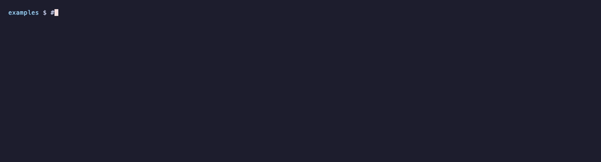

# eslint-plugin-tailwind-design-tokens

[](https://github.com/KMavr/eslint-plugin-tailwind-design-tokens/actions/workflows/ci.yml)
[](https://www.npmjs.com/package/eslint-plugin-tailwind-design-tokens)
[](https://www.npmjs.com/package/eslint-plugin-tailwind-design-tokens)
[](https://www.npmjs.com/package/eslint-plugin-tailwind-design-tokens)
[](https://www.npmjs.com/package/eslint-plugin-tailwind-design-tokens)
[](./LICENSE)
[](https://www.npmjs.com/package/eslint-plugin-tailwind-design-tokens)
[](https://eslint.org)
[](https://tailwindcss.com)
[](https://conventionalcommits.org)

ESLint plugin that flags hardcoded colors, default Tailwind palette classes and arbitrary spacing
values, steering you toward your design-system tokens.



## Why

A design system defines a finite color palette as tokens — `--color-ink`, `bg-primary`,
`text-soft-green`. But nothing stops a raw `#0a0a0a`, an `rgb(10 10 10)`, or a stock `text-red-500`
from sneaking into a component, and every one of those quietly erodes the system. This plugin
catches them at lint time and, when the hardcoded value matches one of your tokens, tells you exactly
which token to use instead.

Spacing drifts the same way. In Tailwind v4 every numeric spacing class is on the scale (`p-13` is
`13 × --spacing`), so an arbitrary `p-[17px]` is the spacing equivalent of a raw hex. The plugin
flags those too and points you at the on-scale class or a named `--spacing-*` token.

For colors, it understands where tokens live across Tailwind versions — a v4 `@theme` block, a v3
`tailwind.config.js`, or an inline map — so it works whatever your setup. Spacing checks are
Tailwind v4 only.

## Before / after

```jsx
// ✗ flagged — stock palette class + hardcoded hex + arbitrary spacing
<button className="bg-[#0a0a0a] text-red-500 px-[16px] mt-[1.5rem]" />;

// ✓ design-system tokens and the spacing scale
// (bg-[#0a0a0a] → bg-ink when #0a0a0a maps to a token; px-[16px] → px-4 and
//  mt-[1.5rem] → mt-6 are auto-fixable)
<button className="bg-ink text-primary px-4 mt-6" />;
```

## Install

```sh
npm install --save-dev eslint-plugin-tailwind-design-tokens
# or
yarn add --dev eslint-plugin-tailwind-design-tokens
# or
pnpm add --save-dev eslint-plugin-tailwind-design-tokens
```

Requires ESLint 9+ (both the legacy `.eslintrc` and the flat config systems are supported).

Every release is published from CI with
[npm provenance](https://docs.npmjs.com/generating-provenance-statements) attestations, so each
version on npm links back to the exact commit and workflow that built it.

## Usage

### Flat config (ESLint 9+, `eslint.config.mjs`)

Quick start with the recommended config:

```js
import tailwindDesignTokens from 'eslint-plugin-tailwind-design-tokens';

export default [...tailwindDesignTokens.configs['flat/recommended']];
```

Recommended turns the two color rules on as errors. `no-arbitrary-spacing` is opt-in for now. To get
**token suggestions** (not just "hardcoded color" warnings) and enable the spacing rule, point the
rules at your token source:

```js
import tailwindDesignTokens from 'eslint-plugin-tailwind-design-tokens';

export default [
  {
    plugins: { 'tailwind-design-tokens': tailwindDesignTokens },
    rules: {
      'tailwind-design-tokens/no-default-palette': 'error',
      'tailwind-design-tokens/no-hardcoded-colors': [
        'error',
        { cssFile: './src/styles/globals.css' },
      ],
      'tailwind-design-tokens/no-arbitrary-spacing': [
        'error',
        { cssFile: './src/styles/globals.css' },
      ],
    },
  },
];
```

### Legacy config (`.eslintrc.json`)

```json
{
  "plugins": ["tailwind-design-tokens"],
  "extends": ["plugin:tailwind-design-tokens/recommended"]
}
```

Or configure the rules directly to add a token source:

```json
{
  "plugins": ["tailwind-design-tokens"],
  "rules": {
    "tailwind-design-tokens/no-default-palette": "error",
    "tailwind-design-tokens/no-hardcoded-colors": [
      "error",
      { "cssFile": "./src/styles/globals.css" }
    ],
    "tailwind-design-tokens/no-arbitrary-spacing": [
      "error",
      { "cssFile": "./src/styles/globals.css" }
    ]
  }
}
```

## Rules

<!-- begin auto-generated rules list -->

💼 Configurations enabled in.\
✅ Set in the `recommended` configuration.\
🔧 Automatically fixable by the [`--fix` CLI option](https://eslint.org/docs/user-guide/command-line-interface#--fix).\
💡 Manually fixable by [editor suggestions](https://eslint.org/docs/latest/use/core-concepts#rule-suggestions).

| Name                                                       | Description                                                                                            | 💼  | 🔧  | 💡  |
| :--------------------------------------------------------- | :----------------------------------------------------------------------------------------------------- | :-- | :-- | :-- |
| [no-arbitrary-spacing](docs/rules/no-arbitrary-spacing.md) | Disallow arbitrary spacing values; use the spacing scale or design-system tokens                       |     | 🔧  | 💡  |
| [no-default-palette](docs/rules/no-default-palette.md)     | Disallow default Tailwind palette colors; use design-system tokens                                     | ✅  |     |     |
| [no-hardcoded-colors](docs/rules/no-hardcoded-colors.md)   | Disallow hardcoded color values (hex, rgb, hsl, hwb, lab, lch, oklab, oklch); use design-system tokens | ✅  | 🔧  | 💡  |

<!-- end auto-generated rules list -->

## Configuring tokens

`no-hardcoded-colors` can read your design tokens from any combination of these sources (later
sources win on conflict: **cssFile < configFile < tokens**):

| Option       | Tailwind | What it reads                                                                                                                                                |
| ------------ | -------- | ------------------------------------------------------------------------------------------------------------------------------------------------------------ |
| `cssFile`    | v4       | `--color-*` declarations inside the `@theme { … }` block of the given CSS file.                                                                              |
| `configFile` | v3       | `theme.colors` / `theme.extend.colors` from a `tailwind.config.js` (nested palettes are flattened, e.g. `brand-500`; a `DEFAULT` key maps to the bare name). |
| `tokens`     | any      | An inline `{ "<color>": "<token-name>" }` map — for projects whose tokens live outside Tailwind.                                                             |

```js
'tailwind-design-tokens/no-hardcoded-colors': ['error', {
  cssFile: './src/styles/globals.css',     // Tailwind v4 @theme
  configFile: './tailwind.config.js',       // Tailwind v3
  tokens: { '#0a0a0a': 'ink' },             // inline / non-Tailwind
  allow: ['transparent', '#ffffff'],        // colors to ignore
}]
```

Color values are normalized before matching, so `#FFF` in your code matches a token defined as
`#ffffff`. Hex and the CSS color functions `rgb()`, `hsl()`, `hwb()`, `lab()`, `lch()`, `oklab()`,
and `oklch()` are all detected, including inside Tailwind arbitrary values like `bg-[#0a0a0a]`. Hex
is only reported where it is certainly a color (the whole string, an arbitrary value, or a CSS
declaration), so `issue #123` and `href="#add"` are left alone.

`no-arbitrary-spacing` reads `--spacing` (the scale base, default `0.25rem`) and `--spacing-*`
(named tokens) from the same `@theme` blocks via its own `cssFile` option. It also takes
`rootFontSize` and `stepIncrement`; see [the rule docs](docs/rules/no-arbitrary-spacing.md).

## How it works

- **`no-hardcoded-colors`** scans every string literal and template-literal quasi for color values,
  normalizes each, and looks it up in your token map. A match reports _"use the design token X"_; no
  match reports _"unexpected hardcoded color"_.
- **`no-default-palette`** splits class strings and flags any default Tailwind palette utility
  (`prefix-family-shade`), tolerating important (`!`) and opacity (`/50`) modifiers.
- **`no-arbitrary-spacing`** splits class strings, finds arbitrary `px`/`rem` values in spacing and
  sizing utilities, and converts them to the scale. One match is auto-fixed, several are offered as
  suggestions, and an off-scale value is reported without a fix. `calc()`, `var()`, `%` and
  viewport units are left alone.

Token files are read once and cached per ESLint process, invalidated by file mtime.

## Contributing

Issues and PRs welcome — see [CONTRIBUTING.md](./CONTRIBUTING.md) for setup, the test/doc workflow,
and commit conventions. Quick start:

```sh
npm install
npm test          # vitest
npm run lint
npm run typecheck
npm run build
```

## License

[MIT](./LICENSE) © Konstantinos Mavrikas
